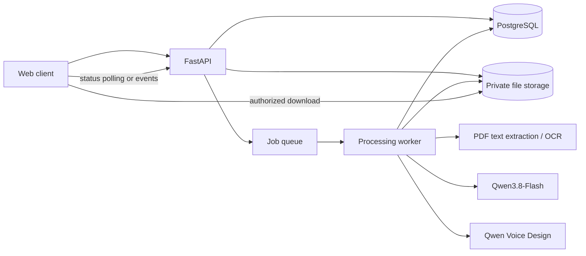

# Implementation Plan: AI Audiobook Creator

**Status:** Draft  
**Version:** 0.1  
**Last updated:** 2026-09-27  
**Product requirements:** [PRD.md](PRD.md)

## 1. Delivery objective

Deliver a private web app that accepts a text-based PDF, lets a user review extracted text and AI-suggested speakers, assigns stable voice profiles, generates speech through Alibaba Cloud Model Studio Qwen Voice Design, and produces a downloadable MP3. Text analysis uses the selected Qwen3.8-Flash Model Studio listing.

The work is ordered to reduce risk early: first verify the two model APIs and voice continuity, then build a thin end-to-end vertical slice, then improve review, resumability, and hardening. AO3 imports, synchronized highlighting, mobile packaging, and manga processing remain outside the initial delivery.

## 1.1 Current code status

An initial local MVP has been added under `app/`: FastAPI serves a browser UI and project API; SQLite stores projects, passages, speakers, jobs, and audio segment records; one in-process worker handles PDF extraction, Qwen3.8-Flash speaker analysis, Qwen Voice Design previews, speech synthesis, and MP3 assembly. The root-level manga and summarization scripts remain separate experiments.

The Model Studio adapters follow the documented Singapore model IDs and request flow, but have not yet been exercised with a live API key. Treat the integration as implemented but unverified until the Phase 0 smoke run succeeds. This is a local single-user prototype: it has no authentication, is intended to bind to localhost, and uses one worker process. Production hardening, broad sample evaluation, and roadmap features remain outstanding.

## 2. Key implementation choices

These are recommended starting choices; adjust only if repository constraints or the model spike show a clear need.

- **Web client:** React with TypeScript and a simple responsive interface.
- **API:** Python FastAPI, matching the existing repository language and AI prototypes.
- **Background work:** a separate worker process for extraction, model calls, TTS, and MP3 assembly. Use a durable queue and shared database rather than running long jobs inside HTTP requests.
- **Persistence:** PostgreSQL for users, projects, passages, speaker profiles, job state, and audio manifest.
- **File storage:** private object storage for source PDFs and generated audio; local filesystem storage is acceptable for initial local development only.
- **PDF text extraction:** use a selectable-text extractor first. Add OCR as a separately switchable path for pages with missing/poor text.
- **Audio assembly:** normalize generated segments to compatible sample rate/channel settings and encode the final MP3 with a backend audio tool. Record segment metadata for retries and later playback alignment.
- **Model integrations:** separate `TextAnalyzer` and `SpeechGenerator` adapters. Keep Model Studio credentials on the backend and read them from environment or deployment secrets.
- **Model choices:** Qwen3.8-Flash for text analysis and Qwen Voice Design / Qwen3-TTS-VD for TTS, both through Alibaba Cloud Model Studio. Confirm exact API model IDs, endpoint, regional availability, authentication, rate limits, terms, and pricing before production use.

## 3. System outline

The API handles authentication, project metadata, upload authorization, user edits, job creation, and status reads. The worker executes long-running stages and checkpoints their outputs. Neither model should be called directly from the browser.

## 4. Phase 0: repository and model integration spike

### Work

1. Review existing scripts and environment configuration. Preserve useful PDF/audio experiments, but do not treat the current scripts as production-ready services.
2. Confirm Model Studio API details for the two selected listings in the intended service region:
   - exact text and TTS model identifiers;
   - API-compatible endpoint and authentication method;
   - request/response shapes and supported audio formats;
   - rate limits, quotas, pricing, and request-size limits;
   - supported languages and commercial/use terms.
3. Make a small backend-only call to Qwen3.8-Flash with several representative story passages. Validate schema-constrained output for speaker IDs, exact text spans, narration, and uncertainty.
4. Generate repeated passages for the same designed voice through Qwen Voice Design. Measure voice consistency across calls, language/pronunciation quality, latency, returned audio format, and whether a reusable voice identity or profile is supported.
5. Test an end-to-end audio assembly from multiple returned clips to MP3, including silence/pause handling and normalization.
6. Create a small evaluation pack of representative PDFs/passages: clean prose, frequent dialogue, ambiguous speakers, names/pronunciation, long chapters, and a scanned PDF.

### Exit criteria

- A documented, working request/response example exists for both selected services.
- Credentials are loaded from environment/deployment secrets and are absent from source code.
- Model output can be validated into the proposed internal schema.
- A voice continuity approach is selected and documented.
- Go/no-go risks and estimated per-hour audio cost are understood before committing to full generation implementation.

## 5. Phase 1: application foundation

### Work

- Establish separate frontend, API, and worker packages with shared configuration and clear local startup instructions.
- Add environment-based settings and a checked-in `.env.example` containing variable names only.
- Define database migrations and core entities:
  - `User` (if authentication is enabled for the first deployment);
  - `Project` and source file metadata;
  - `Passage` with order, page reference, extracted text, edited text, and revision;
  - `Speaker` with stable project ID, display name, voice direction, and selected TTS profile;
  - `PassageSpeaker` attribution and confidence/source evidence;
  - `Job` and stage-level status/error/retry fields;
  - `AudioSegment` and final audio manifest.
- Add authenticated project CRUD and private upload/download authorization.
- Set file type, size, page count, job concurrency, and request timeouts as configuration.
- Add structured logs with job IDs and error categories; exclude source text, API secrets, and signed URLs.

### Exit criteria

- A user can create a project, upload a PDF to private storage, see it listed, and delete it.
- Database and worker can be started locally from documented setup steps.
- An upload cannot be accessed by a different user/project through guessed identifiers.

## 6. Phase 2: PDF extraction and text review

### Work

- Implement a PDF intake job that checks readability and extracts selectable text in page order.
- Detect pages with little/no selectable text and report them; route to OCR only if OCR is enabled and configured.
- Preserve page boundaries and paragraph order in passage records.
- Normalize whitespace and encoding without deleting or rewriting meaningful content.
- Display extraction progress, page-level errors, and a text review/editor view.
- Store extracted text separately from user edits and version edits.
- Allow a user to exclude front matter or unwanted ranges before speaker analysis.

### Exit criteria

- Supported text PDFs produce ordered, editable passages with page references.
- Scanned/unsupported pages are clearly identified rather than silently omitted.
- User edits survive refresh and are the exact source sent to later processing.

## 7. Phase 3: text analysis and speaker review

### Work

- Define a versioned JSON schema for analysis responses and validate every model response.
- Chunk long documents by paragraph/passage with overlap or context summaries that preserve character identities between chunks.
- Send only necessary source text and context to Qwen3.8-Flash.
- Require passage identifiers and exact source text/span references in the response. Model labels should point to source passages; text itself remains unchanged.
- Create/merge stable speaker IDs across chunks and keep narration as a distinct assignment.
- Store confidence and ambiguity; flag low-confidence or unattributed dialogue for user review.
- Build review UI for speaker rename, merge, split, passage reassignment, voice direction edits, and approval.
- Support retrying invalid/failed chunks without losing completed analysis or user corrections.

### Exit criteria

- Analysis output maps to source passages and invalid/unmatched outputs are rejected safely.
- Users can correct all speaker decisions needed for generation.
- Re-running analysis does not silently overwrite approved user edits.

## 8. Phase 4: voice setup and TTS generation

### Work

- Implement the `SpeechGenerator` adapter for Qwen Voice Design using confirmed Model Studio API details.
- Define voice profiles with the TTS provider model/version, voice instructions/profile identifier if supported, language, pronunciation overrides, and project speaker mapping.
- Create speaker and narration voice setup UI, with generated sample previews where available.
- Run short audio previews before the full job so users can adjust voice directions.
- Generate approved passages in reading order, checkpoint each segment, and associate each with a text revision and speaker profile version.
- Retry transient errors with bounded backoff; allow cancellation and resume.
- If text or voice settings change, invalidate and regenerate only affected segments.
- Normalize audio segments and assemble a final MP3; preserve a manifest mapping each segment to its passage and timestamps/duration.
- Report progress by completed/total segments and surface specific failures.

### Exit criteria

- A complete project generates a playable MP3 in source reading order.
- Failed segments can be retried without regenerating successful unchanged segments.
- Speaker voices remain acceptably consistent across multiple passages in the evaluation set.
- Final output and segment manifest are stored privately and downloadable by the project owner.

## 9. Phase 5: MVP hardening and release

### Work

- Test the full flow with clean, dialogue-heavy, long, and poor-quality documents.
- Add limits and clear UI messaging for file size, page count, unsupported languages, quotas, and expected generation time/cost.
- Add job timeout, cancellation, retry, and cleanup handling.
- Verify project deletion removes database records, source files, and generated segments/final audio according to the retention policy.
- Add monitoring for job duration, per-stage failures, retry rate, output duration, and provider errors without content logging.
- Document deployment, secrets, backups, migrations, operational recovery, and provider configuration.
- Conduct accessibility review for keyboard use, focus, labels, status announcements, and contrast.

### Release gate

- PRD MVP acceptance criteria pass on representative sample documents.
- No credentials are committed or emitted in logs.
- Privacy, retention, and deletion behavior are documented and verified.
- Known model limitations and supported input constraints are visible to users.

## 10. API and data contract outline

Suggested initial endpoints (exact route names may change):

- `POST /api/projects` — create a project.
- `GET /api/projects` / `GET /api/projects/{id}` — list/read projects and status.
- `POST /api/projects/{id}/source` — upload/attach a PDF.
- `POST /api/projects/{id}/extract` — enqueue extraction.
- `GET /api/projects/{id}/passages` — fetch ordered passages and page references.
- `PATCH /api/projects/{id}/passages` — save reviewed text and passage edits.
- `POST /api/projects/{id}/analysis` — enqueue speaker analysis.
- `GET/PATCH /api/projects/{id}/speakers` — review speaker and voice profiles.
- `POST /api/projects/{id}/audio` — start or resume TTS generation.
- `GET /api/jobs/{id}` — read progress and errors.
- `GET /api/projects/{id}/audio` — retrieve authorized final audio metadata/download.
- `DELETE /api/projects/{id}` — delete a project and associated files.

All mutating operations should be owner-authorized and idempotent where practical. Long-running operations return a job identifier rather than holding an HTTP request open.

## 11. Internal contracts

### Text analysis input

- Project and passage IDs (opaque identifiers, not assumed to be model output).
- Ordered source text with page/paragraph references.
- Compact character context from prior analyzed chunks.
- Explicit instructions to preserve text, mark uncertainty, and avoid inventing speaker identity.

### Text analysis output

- `passage_id`
- `source_text` or exact span reference that must match input
- `speaker_id` or `narration` / `unknown`
- optional speaker candidate and confidence
- ambiguity reason or evidence note, if useful
- speaker voice direction suggestion with confidence/evidence kept separate

### TTS input/output

- Input: approved passage text, language, stable speaker voice profile, pronunciation overrides, generation settings, idempotency key.
- Output: audio bytes or private object reference, format/sample rate/duration metadata, provider request ID, model/version, and retryable/non-retryable error classification.

Never trust model-generated IDs as database primary keys; map them through validated internal IDs.

## 12. Risks, dependencies, and decisions

| Item | Owner/action | Needed by |
|---|---|---|
| Confirm Model Studio API IDs/endpoints and Southeast Asia region support | Engineering spike | Phase 0 |
| Verify persistent voice consistency across separate TTS calls | Engineering/product evaluation | Phase 0 |
| Confirm pricing, quota, commercial terms, retention/data processing terms | Product/operations | Before external users |
| Select auth approach and initial deployment target | Product/engineering | Phase 1 |
| Set supported languages and PDF limits | Product | Phase 1 |
| Choose OCR approach and supported scan quality | Engineering | Phase 2 |
| Define retention period and deletion guarantees | Product/operations | Phase 1 release gate |
| Select queue, database, and object-storage services | Engineering | Phase 1 |

The primary technical risk is long-form voice consistency with voice design across independent generation requests. The Phase 0 evaluation should resolve whether the chosen service supports a reusable voice identity or needs a carefully managed speaker-specific approach before full TTS implementation.

## 13. Future phases

### AO3 and other story sources

- Implement an importer adapter that creates the same normalized project/passages as PDF extraction.
- Confirm permitted access and site rules before implementing any site-specific retrieval.
- Keep source attribution and chapter structure in project metadata.

### Synchronized browser playback

- Use the passage/audio manifest to play segments and highlight the active passage.
- Add sentence-level or word-level alignment only after evaluating timestamp alignment quality.

### Android client

- Reuse the authenticated API and project/audio model.
- Add background download/offline playback and Android-specific playback controls.

### Manga mode

- Add a visual ingestion path for page rendering, panel ordering, text detection/OCR, and speaker inference from visual context.
- Reuse speaker/voice profiles, TTS, job processing, and audio assembly where appropriate.

## 14. Suggested first engineering tickets

1. Document Model Studio API configuration and create minimal calls to both selected models.
2. Evaluate reusable voice consistency and record representative audio examples.
3. Establish app skeleton (React client, FastAPI API, worker, database, queue, storage adapters).
4. Add project and PDF upload lifecycle with private storage and deletion.
5. Extract text into ordered, editable passage records.
6. Add analysis schema, Qwen3.8-Flash adapter, and speaker review UI.
7. Add voice profile editing and TTS preview.
8. Add resumable passage generation, MP3 assembly, and download.
9. Harden privacy, limits, observability, and release documentation.
